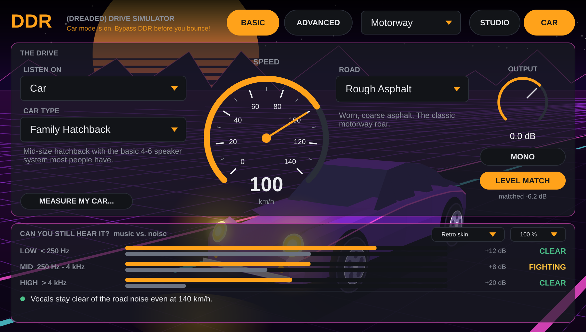
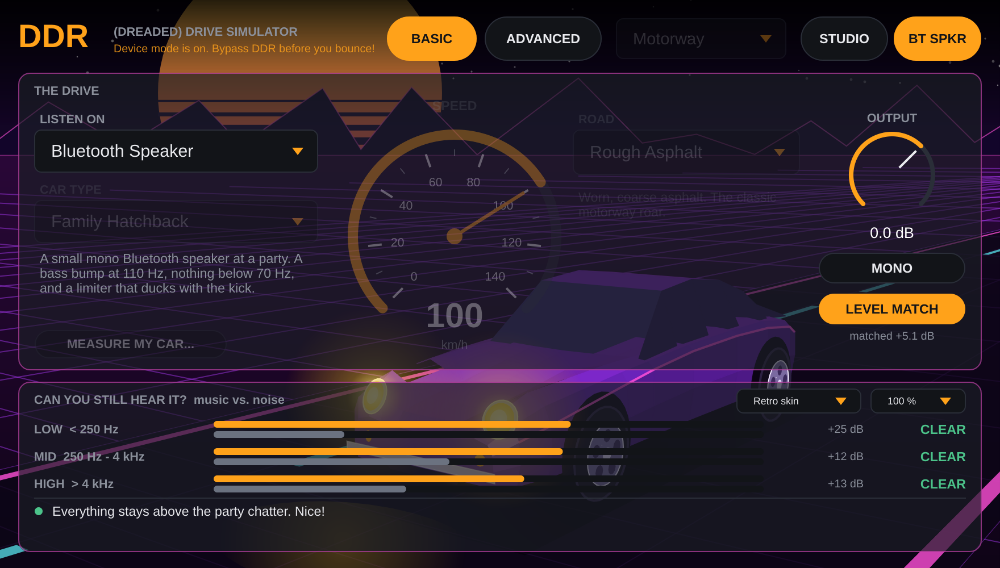
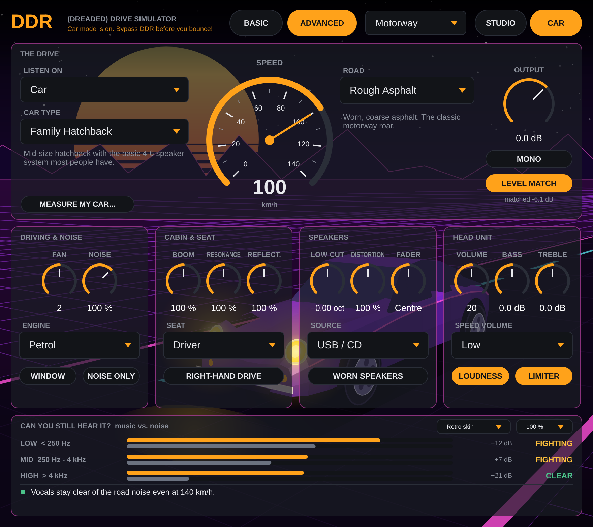
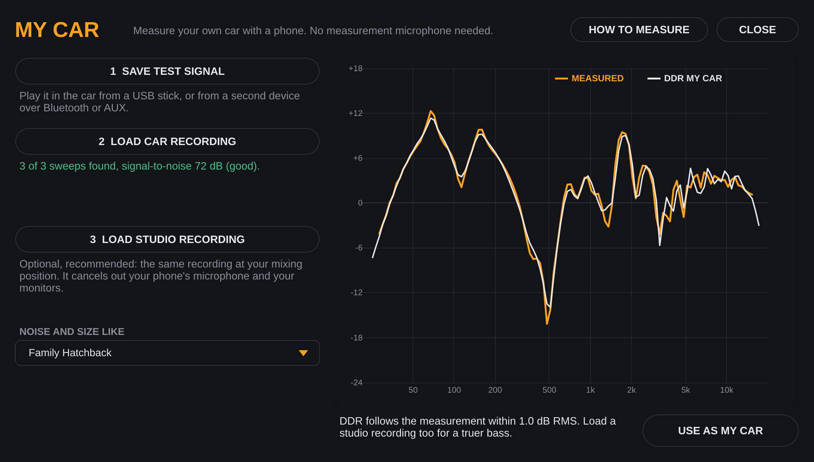

# DDR – (Dreaded) Drive Simulator

**A free VST3 plugin for Windows, macOS and Linux (plus Audio Unit on macOS for Logic and GarageBand) that lets you hear your mix the way it sounds in an ordinary family car** – with the stock speakers, the cabin boom and the road noise. Put it last on your master bus, pick a car, set the speed and check whether the vocal, the bass and the snare still make it through.



## Why songs sound worse in the car

| What happens | What it does to the mix |
| --- | --- |
| **Road, tyre, wind and engine noise** – roughly 65–72 dB(A) at 100 km/h, mostly below 500 Hz | Masks the bass line, the low end of the kick and the quiet details |
| **Cabin boom** – a small closed space lifts everything below ~80 Hz and adds strong resonances at 60–200 Hz | Bass gets thick and single notes jump out |
| **Cheap door speakers** – no real bass below 70–100 Hz, peaks and dips around the crossover, distortion when loud | Vocal and snare clarity depends on a bumpy 1–4 kHz range |
| **You sit to one side** – the near speaker arrives ~1–2 ms earlier and louder | The centre image moves, comb filtering colours the mids |
| **Head unit tricks** – loudness, speed-dependent volume, limiter | Dynamics get squashed or pumped |

DDR simulates all of these.

## Controls

**Basic** – everything most people need:

- **Car type** – Family Wagon, Family Hatchback, Old Family Car, City Car, Family SUV, Premium Sedan (reference), or **My Car** – your own car, measured with a phone (see below)
- **Speed** – 0–140 km/h. Raises road, wind and engine noise like a real drive
- **Road** – Smooth Asphalt, Rough Asphalt, Studded Tyres, Gravel, Wet Road
- **Listen on** – Car, or one of the other places your song gets played: **Phone Speaker** (on a kitchen table), **Cheap Earbuds** (on a bus) or **Bluetooth Speaker** (at a party). Each has its own speaker sound and background noise
- **STUDIO / CAR** – A/B switch. Level matched with K-weighting, like a loudness meter, so the louder side never "wins"; the amount it matched is shown under **Level Match**
- **Situation** – Parked, City, Motorway, Winter Motorway, Windows Down, Back Seat
- **Output**, **Mono**, **Level Match**
- **Skin** – Retro (an 80s night drive behind the controls) or Plain, plus a window size menu (75–150 %)
- **Can you still hear it?** – shows per band (low / mid / high) if your music is CLEAR, FIGHTING or MASKED by the noise
- **Mix hints** – plain-English tips under the meter, for example *"Vocals (1-4 kHz) get masked from about 105 km/h"* or *"Bass below 200 Hz nearly vanishes on a phone speaker"*. In a car DDR works out the speed where each part of your mix goes under the road noise. The hints are estimates from band levels, so use them as a pointer and trust your ears



**Advanced** – everything else:



| Group | Controls |
| --- | --- |
| Driving & noise | Fan (0–4), Noise amount, Engine (Petrol / Diesel / Electric), Window open, Noise only |
| Cabin & seat | Boom, Resonance, Reflections, Seat (Driver / Front Passenger / Back Seat / Sweet Spot), Right-hand drive |
| Speakers | Low cut shift, Cone distortion (incl. door rattle), Fader (front/rear), Worn speakers, Source (USB / Bluetooth / FM radio) |
| Head unit | Volume (0–40), Bass, Treble, Speed volume (Off / Low / High), Loudness, Limiter |

The car presets are educated guesses at typical stock systems, not measurements of any specific car.

## My Car: measure your own car with a phone

Play DDR's test signal in your car, record it with your phone, and load the recording in DDR (**MEASURE MY CAR…** under the car type). DDR finds the sweeps, works out your car's frequency response and fits a car profile to it. Record the same signal at your mixing position too and DDR also cancels out the phone's microphone and your monitors. No measurement microphone needed.



Step-by-step instructions: **[docs/MY-CAR.md](docs/MY-CAR.md)**. Test signal: [DDR-test-signal.mp3](docs/my-car/DDR-test-signal.mp3) (or save it as WAV from DDR).

## Quick workflow

1. Put DDR **last** on the master bus (after your limiter).
2. Pick a car close to what your listeners drive. *Family Hatchback* is a good default.
3. Choose **Motorway** from the Situation menu and play the loudest chorus.
4. Watch **Can you still hear it?** and listen: is the lead vocal still clear? Does the bass line stay even, or do single notes boom?
5. Read the **mix hints**, then flip **STUDIO / CAR** (it is level-matched, so louder never "wins") and fix the mix, not the plugin.
6. Try **City** and **Parked** too: quiet passages and fade-outs disappear first at speed, while the cabin boom is most obvious when parked.
7. Switch **Listen on** to the phone, earbuds and Bluetooth speaker for a last check.
8. **Bypass DDR before you bounce.** The header reminds you while CAR mode is on.

Tips: *Back Seat* and *Mono* show what the kids and Bluetooth speakers hear. *Volume* at 30+ shows how the stock amp and speakers fall apart when people crank it. The noise stops when your DAW's transport stops.

## Download and install

Download from the [Releases page](https://github.com/salleq/ddr-drive-simulator/releases):

| Computer | Easiest | Manual (zip) |
|---|---|---|
| Windows PC (Intel/AMD) | `DDR-…-Windows-x64-Setup.exe` | `DDR-Windows.zip` |
| Windows on ARM (Snapdragon) | `DDR-…-Windows-ARM64-Setup.exe` | `DDR-Windows-ARM64.zip` |
| Mac (Apple Silicon and Intel) | `DDR-…-macOS-Installer.pkg` | `DDR-macOS.zip` |
| Linux x64 / ARM64 | – | `DDR-Linux.zip` / `DDR-Linux-ARM64.zip` |

The installers put the plugin in the standard folders, and the Windows one adds an uninstaller. Manual install steps are in `INSTALL.txt` inside each zip ([read it here](docs/INSTALL.txt)).

**macOS:** DDR is free and not notarized by Apple (that needs a paid developer account), so the first time you open the `.pkg` macOS says it can't check it. Open **System Settings → Privacy & Security**, scroll down and click **Open Anyway**. You only do this once.

**Windows:** SmartScreen may say "Windows protected your PC" because the installer is not code-signed. Click **More info → Run anyway**.

## Build it yourself

You need CMake 3.22+ and a C++17 compiler (Xcode on macOS, Visual Studio 2022 on Windows, GCC or Clang on Linux). JUCE is downloaded automatically.

On Linux, install the JUCE dependencies first (Debian/Ubuntu):

```sh
sudo apt install libasound2-dev libx11-dev libxrandr-dev libxinerama-dev libxcursor-dev \
  libxext-dev libxcomposite-dev libfreetype-dev libfontconfig1-dev
```

```sh
cmake -B build -DCMAKE_BUILD_TYPE=Release
cmake --build build --config Release --target DDR_VST3
```

Developer extras:

- `-DJUCE_DIR=/path/to/JUCE` uses a local JUCE checkout instead of downloading it
- `-DDDR_BUILD_TOOLS=ON` builds `ddr_snapshot`, which renders the UI to PNG and runs a quick level and stability check, and `ddr_caltest`, which tests My Car end to end with a simulated car and phone (`ddr_caltest --analyse recording.wav` prints the measured curve of a real recording)

GitHub Actions builds and validates (pluginval) all three platforms on every push. Pushing a tag like `v0.1.0` publishes a release with the zips.

## How it works

```
mix ─► source ─► head unit ─► speakers ─► cabin + seat ─► (+) ─► level match ─► out
       BT/FM      loudness,     low cut,     boom, modes,    ▲
                  SVC, limiter  EQ, cone     reflections,    │
                                distortion   seat delays     │
                                                     noise generator
                                       road, tyres, wind, engine, fan
```

The noise is added after the car stereo, because it reaches your ears directly. Noise levels are set in dB SPL and mapped so that a typical master plays at a car-like ~83 dB SPL. Level match keeps CAR mode as loud as your input, and gives the noise the same gain, so turning the car volume up lifts the music above the noise just like in a real car.

## Licence

DDR is free software under the [GNU Affero General Public License v3](LICENSE). It is built with [JUCE](https://juce.com), whose free licence option is the AGPLv3, which requires the plugin's source code to stay open under the same licence. You may use DDR freely, including on commercial music.
